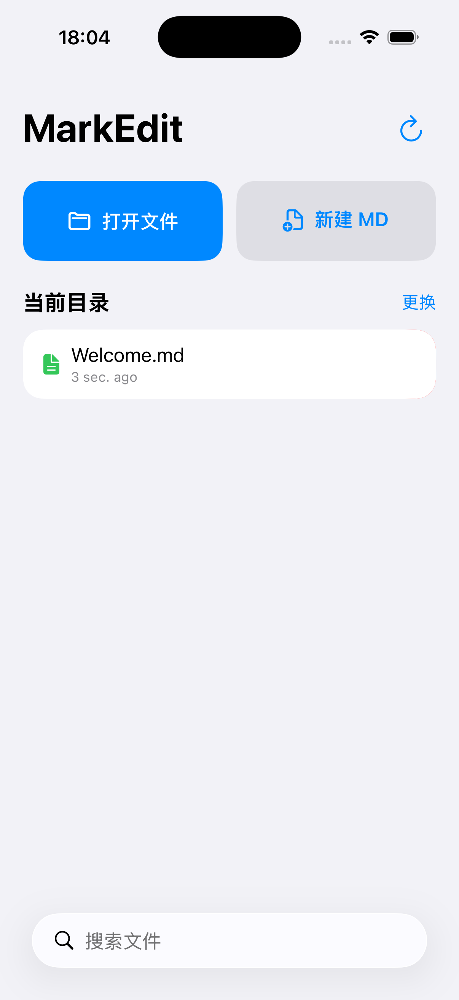

# MarkEdit

<p align="center">
  
</p>

<p align="center">
  <strong>一款简洁的 iOS Markdown 预览与编辑器</strong>
</p>

<p align="center">
  <a href="#功能">功能</a> •
  <a href="#截图">截图</a> •
  <a href="#环境要求">环境要求</a> •
  <a href="#如何运行">如何运行</a> •
  <a href="#项目结构">项目结构</a> •
  <a href="#已知限制">已知限制</a>
</p>

---

## 简介

MarkEdit 是一个基于 **SwiftUI + WKWebView** 的 iOS Markdown 编辑器，最低支持 **iOS 15**。

它让你在 iPhone 或 iPad 上方便地浏览、编辑和预览 Markdown 文件，支持代码高亮、主题切换、HTML/PDF 导出，并能从系统「文件」App 中直接打开 `.md` 文件。

> 本项目为开源 MVP，适合有 Mac 和 Xcode 的开发者自行编译安装。由于 iOS 生态限制，未上架 App Store，暂无法直接通过 App Store 分发。

---

## 功能

- 📁 在 App 内浏览沙盒 Documents 目录中的 Markdown 文件
- 📝 新建、删除 Markdown 文件
- ✏️ 使用原生 `TextEditor` 编辑 Markdown
- 👁️ 实时预览渲染结果（Marked / JavaScriptCore → HTML → WKWebView）
- 📋 支持 GFM 表格（对齐、横向滚动）、任务清单、删除线和自动链接
- 🎨 代码高亮（highlight.js）
- 🌗 浅色 / 深色 / 跟随系统主题
- 🖌️ 代码主题切换：GitHub / GitHub Dark / Atom One Dark
- 📤 导出为 HTML 或 PDF，通过系统分享面板发送
- 📂 从系统「文件」App 中打开 `.md` 文件
- 🔗 通过 Document Picker 选择外部文件夹并记住访问权限

### 文件选择回归检查（iOS 26）

首页「打开文件」用于选择 `.md`、`.markdown`、`.mkd` 文件；「当前目录 → 更换」用于选择文件夹。外部文件按原位置编辑，保存会写回原文件。

- 在「我的 iPhone」及 iCloud Drive 中分别选择 Markdown 文件，确认进入编辑页并显示文件内容。
- 修改内容并保存，在「文件」App 中确认原文件已更新；重启 MarkEdit 后从「最近打开」再次打开。
- 取消选择或下滑关闭后，再次点击「打开文件」，确认选择器仍可正常打开。
- 使用「当前目录 → 更换」选择文件夹，确认列出其中的 Markdown 文件。
- 文件被删除或访问失败时，确认显示错误，并保留原有编辑内容，不进入空白编辑页。

上述检查需要在设备或已启动的模拟器中执行；第三方文件提供器还需在真机中验证。

2026-10-08 已在 iPhone 17 Pro / iOS 26.5 模拟器验证：从系统文件选择器打开本地 `Welcome.md`、进入预览和编辑、修改保存、终止并重启应用后从「最近打开」读回修改、取消后重新打开选择器，以及选择文件夹后列出 Markdown 文件。iCloud Drive、第三方文件提供器、无权限和文件删除场景尚未验证。

---

## 截图

| 文件浏览器 | 编辑器 & 预览 |
|---|---|
|  | *更多截图待补充：点击 Welcome.md 进入编辑/预览界面* |

> 提示：如果你想补充更多截图，可以在模拟器或真机上运行后，自行替换 `screenshots/` 目录下的图片。

---

## 环境要求

- macOS 12.5 或更高版本
- Xcode 14.0 或更高版本
- iOS 15.0 或更高版本的目标设备/模拟器
- 一个有效的 Apple ID（用于 Xcode 本地签名）

---

## 如何运行

### 1. 克隆仓库

```bash
git clone https://github.com/YOUR_USERNAME/MarkEdit.git
cd MarkEdit
```

### 2. 用 Xcode 打开项目

双击 `MarkEdit.xcodeproj`，Xcode 会自动解析 Swift Package Manager 依赖（`Vendor/Down`）。

### 3. 配置签名

1. 在 Xcode 左侧项目导航栏中选中 `MarkEdit` 项目
2. 选择 `MarkEdit` Target → **Signing & Capabilities**
3. 在 **Team** 下拉框中选择你的个人 Apple ID（免费账号即可）
4. 如果 Bundle Identifier 显示黄色警告，点击 **Fix Issue** 让 Xcode 自动处理

### 4. 运行

1. 在 Xcode 顶部工具栏选择 **iPhone 15 / iPhone 16 模拟器**，或连接你的 iPhone
2. 按 `Cmd + R` 运行
3. 首次在真机上运行时，需要在 iPhone **设置 → 通用 → VPN 与设备管理** 中信任你的开发者证书

### 5. 重新生成工程（可选）

本项目使用 [XcodeGen](https://github.com/yonaskolb/XcodeGen) 管理工程文件。如果你修改了 `project.yml`，可以重新生成：

```bash
xcodegen generate --project . --spec project.yml
```

---

## 项目结构

```
MarkEdit/
├── App/
│   ├── AppState.swift              # 全局应用状态
│   └── MarkEditApp.swift           # App 入口
├── Models/
│   ├── ExportFormat.swift          # 导出格式枚举
│   ├── FileItem.swift              # 文件模型
│   └── PreviewSettings.swift       # 预览主题设置
├── Services/
│   ├── FileAccessHelper.swift      # 文件访问与权限
│   ├── HTMLExporter.swift          # HTML 导出
│   ├── HTMLRenderer.swift          # HTML 渲染模板
│   ├── MarkdownRenderer.swift      # Markdown → HTML
│   ├── PDFExporter.swift           # PDF 导出
│   └── ThemeManager.swift          # 主题管理
├── ViewModels/
│   ├── EditorViewModel.swift       # 编辑器逻辑
│   └── FileBrowserViewModel.swift  # 文件浏览器逻辑
├── Views/
│   ├── DocumentPicker.swift        # 文件夹选择器
│   ├── EditorView.swift            # 编辑界面
│   ├── FileBrowserView.swift       # 文件浏览器
│   ├── FileRowView.swift           # 文件列表行
│   ├── MainView.swift              # 主界面
│   ├── PreviewView.swift           # 预览界面
│   ├── PreviewWebView.swift        # WKWebView 包装
│   ├── SettingsToolbarView.swift   # 设置工具栏
│   └── ShareSheet.swift            # 分享面板
├── Resources/
│   ├── LaunchScreen.storyboard     # 启动屏
│   ├── atom-one-dark.min.css       # 代码主题
│   ├── github-dark.min.css
│   ├── github.min.css
│   ├── highlight.min.js            # 代码高亮
│   ├── markdown.css                # Markdown 渲染样式
│   └── print.css                   # PDF 打印样式
└── Info.plist                      # 应用配置
```

---

## 依赖

- [Marked](https://github.com/markedjs/marked) 12.0.2 — 内置在 `MarkEdit/Resources/marked.js`，由系统 JavaScriptCore 同步解析 Markdown，预览和 HTML/PDF 导出共用解析结果；MIT 许可证随应用打包。固定 UMD 版本以兼容目标系统，不需要联网加载。
- [Down](https://github.com/johnxnguyen/Down) — 保留的本地 vendored 依赖，当前预览解析已改用 Marked
- [highlight.js](https://highlightjs.org/) 11.9.0 — 代码高亮

---

## 示例文档

`SampleDocuments/` 目录下包含了一些测试和示例 Markdown 文件，你可以通过 Document Picker 打开该文件夹来体验不同 Markdown 元素的渲染效果。

`21-功能块回归测试.md` 覆盖对齐表格、转义竖线、宽表格、任务清单、嵌套列表、引用内表格、代码块和删除线。构建应用后执行 `sh Tests/MarkdownRendering/run.sh`，可在系统 JavaScriptCore 中检查应用实际打包的解析资源。代码和行内代码中的 Markdown 标记保持原样；内嵌原始 HTML 仍沿用原有的禁用策略。

2026-10-08 已在 iPhone 17 Pro / iOS 26.5 模拟器通过文件选择器打开功能块回归文档，验证表格对齐与转义竖线、宽表格独立横向滚动、任务清单、嵌套列表、引用内表格、代码原样显示、删除线，以及浅色/深色预览；HTML 和 PDF 导出均成功生成文件并显示分享面板。实测同时修复了外部文档预览空白，以及页面主题和代码主题不一致时的代码对比度问题。PDF 分页与宽表格的完整打印布局尚未做专项验证。

---

## 已知限制

- 编辑器目前没有 Markdown 语法高亮，使用原生 `TextEditor`
- 从「文件」App 打开的外部文件，其相对路径图片可能受沙盒限制无法加载
- PDF 分页依赖 CSS `@media print`，复杂表格或大图可能需要手动调整样式
- 未上架 App Store，分发需要自己编译或通过 AltStore/SideStore 等侧载方式

---

## 为什么不上架 App Store？

Apple Developer Program 需要 $99/年的年费。对于个人 MVP 或开源小工具，这笔费用可能不划算。本项目采用开源方式分享，任何人都可以免费获取源码并在自己的设备上运行。

如果你希望更简单的分发，也可以：
- 将本项目 clone 后用 Xcode 直接安装到自己的 iPhone
- 使用 [AltStore](https://altstore.io/) 或 [SideStore](https://sidestore.io/) 进行侧载
- 基于本项目做一个 Web 版 Markdown 编辑器

---

## 贡献

欢迎 Issue 和 PR！如果你发现了 bug 或有新功能想法，欢迎提交 Issue 讨论。

---

## License

MIT License — 详见 [LICENSE](LICENSE) 文件。

---

<p align="center">
  Made with ❤️ using SwiftUI
</p>
